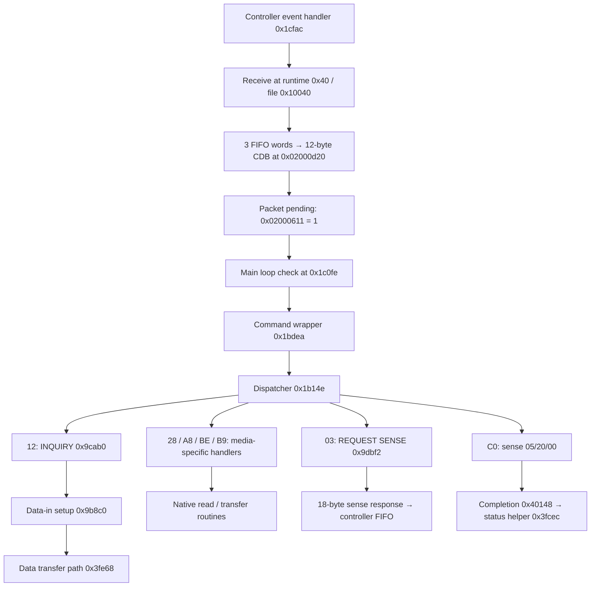

# BW-12B1LT 1.03: SCSI command path

This map applies only to the decoded 2 MiB specimen with SHA-256
`c0a5d073ccfce917712a459b73bff51bcf42bf41ee0703575c0408a59828f84d`.
It identifies reception, dispatch, read parameters, data-in setup and sense
responses. It is an offline research result, not a flashable drive profile.

The main dispatcher is **Thumb code at `0x1b14e`**. It uses comparisons and
three inline halfword jump tables, rather than the original OmniDrive chained
8-byte command records. Adding an entry to `CommandTableEnd` is therefore not
a portable way to introduce `0xC0` on this specimen.

## Reproduce and inspect the evidence

```sh
python3 -m venv /tmp/liteon-research
/tmp/liteon-research/bin/pip install capstone unicorn
/tmp/liteon-research/bin/python tools/liteon/reverse_engineering/map_scsi.py \
  firmware/ASUS_BW-12B1LT_1.03.bin --output-dir dump/scsi-map
```

The output directory must not already exist. The script verifies the specimen
hash before executing anything and opens only the input file and output files.
It emits `scsi-map.json` with inputs, executed instruction addresses, writes,
call boundaries and stub results, and `scsi-disassembly.txt` with annotated
original instructions. Both are under the Git-ignored `dump/` directory.
Capstone and Unicorn are research dependencies only. This run used Capstone
5.0.7 and Unicorn 2.1.4; the report also records their installed versions.

The completed run covers **1,570 experiments**:

- 6 reception experiments, including an occupied-command path and a complete
  synthetic INQUIRY reception that sets the pending flag;
- 1,536 dispatch observations: all 256 opcodes for six synthetic media bytes
  (`00`, `04`, `40`, `50`, `60`, `C0`), plus one failed readiness check;
- 18 read-parser experiments, including both FUA values, READ CD and MSF;
- 9 response experiments: six INQUIRY allocation lengths, two invalid INQUIRY
  fields, and an original REQUEST SENSE routine producing an 18-byte payload.

These are bounded experiments, not a drive emulator. RAM and MMIO are synthetic;
RAM starts at zero except the documented input values. Dispatch stops before
executing handlers and substitutes readiness helper `0x1afb4` with success (or
failure in the dedicated case). Parser experiments explicitly substitute a few
optical helpers and stop at the data-reading function. INQUIRY substitutes two
response-template helpers; the original length and data-in setup code runs.
The JSON records every substitution. No experiment establishes optical success,
interrupt timing, or transport delivery.

## Address convention and low code alias

Except where stated otherwise, code addresses below are file offsets and the
execution addresses used for the main-code experiments. Function entries are
shown even; a Thumb function pointer has bit 0 set.

The receive routine is different: **file `0x10040`, execution `0x40`**. Evidence:

- Main-code calls at `0x1d030` and `0x1d4dc` target `0x40`.
- Decoding the bytes from file `0x10040` at execution address `0x40` makes its
  outbound calls land on the identified routines `0x1ca48`, `0x400c0`,
  `0xa0114`, `0x1bc376` and `0x1c9c8`.
- Its PC-relative literals resolve within the same low block to the CDB and
  controller registers. Vector literals at file `0x10028` and `0x10034` also
  contain low targets `0x3c` and `0x2f4`.

The experiments alias **only file `0x10000..0x103ff` to execution `0..0x3ff`**.
The mechanism establishing this mapping (boot copy, remap or another loader)
has not been traced. Do not subtract `0x10000` from all firmware addresses.
The main startup scatter loader at `0x1ac00` uses records at
`0x1ce2e0..0x1ce36f` for RAM initialization; these records do not establish the
low executable alias.

## Reception → dispatch → response



The arrows combine static control-flow and bounded experiments; this is not a
single uninterrupted end-to-end emulation. The diagram shows the common path.
`0xa0114` also handles commands immediately or defers them according to state;
INQUIRY and REQUEST SENSE can reach the same handlers through this path.
`0x9f5...` contains another state-dependent command selection path. A patch must
account for these alternatives instead of assuming `0x1b14e` sees every packet.

At runtime `0x7c`, `0x7e`, `0x80`, reception reads the same MMIO address
`0x040400a8` three times as 32-bit words. Runtime `0x84..0xac` stores their bytes,
least-significant byte first, into `CDB[0..11]`. Runtime `0x1cc` sets
`0x02000611 = 1`. The main loop tests this flag at `0x1c104..0x1c10a`, then the
wrapper calls the dispatcher at `0x1be14`.

If `0x0200060f` is already nonzero, the receive routine takes its occupied path,
sets `0x02000615`, and does not read the FIFO or replace the CDB. The buffer is
global and mutable, not a per-command allocated object. Handlers reuse bytes
such as `CDB[11]` for intermediate results, and some normalize `CDB[1]`, `[9]`
or `[10]`. Save original fields before calling these handlers if they are needed
later. Buffer ownership under interrupts and all state transitions remain open.

## Main dispatch decisions

The packet branch is selected by nonzero `0x02000611`. Zero selects a separate
ATA-command branch. REQUEST SENSE is checked at `0x1b224`; the general packet
opcode selection starts at `0x1b232`.

| Opcode | Main dispatch arm | Handler / condition |
|---|---|---|
| `03` REQUEST SENSE | `0x1b224` | `0x9dbf2`, without the readiness helper |
| `12` INQUIRY | `0x1bbfa` | `0x9cab0`; clears sense first |
| `28` READ(10) | `0x1b41e` | Shared media selection below |
| `A8` READ(12) | `0x1b41e` | Same arm as READ(10) |
| `BE` READ CD | `0x1b45e` | Separate media selection below |
| `B9` READ CD MSF | `0x1b4aa` | `0xe4b78` when `(media & 0xC4) == 4`; otherwise sense `05/30/02` |
| `C0` | default at `0x1bba4` | Stores `05/20/00` and returns; no custom handler |

For the tested read paths, readiness helper `0x1afb4` receives `r0=1`; a zero
return aborts dispatch. Other state checks can also divert execution.

| Condition on byte at `0x01ffabf0` | READ(10)/READ(12) | READ CD |
|---|---|---|
| `media >> 6 == 3` (BD family interpretation) | `0xace90` | `0xad130` |
| `(media & 0xC4) == 4` (CD family interpretation) | `0xe468c` | `0xe48e8` |
| `media >> 6 == 1` (DVD family interpretation) | `0xc8404` | `0xc8404` with additional field restrictions |

These masks and destinations are established by the code. Family names are
supported by the parameter conversions and downstream code, but the full set
of valid media-byte encodings has not been established. Reaching a handler for
`BE` on DVD/BD does not establish general READ CD support on those media.

Inline switch tables contain **unsigned 16-bit relative offsets**, not function
pointers. Targets are `base + 2 * entry`:

| Table file offset | Opcode interval | Entries | Target base |
|---|---|---:|---|
| `0x1b2e6` | `45..52` | 14 | `0x1b2e8` |
| `0x1b378` | `A1..BE` | 30 | `0x1b37a` |
| `0x1b40c` | `F7..FF` | 9 | `0x1b40e` |

The extracted entries and executed routes are in `scsi-map.json`. None is an
original-style chained command-table terminator available for extension.

## RAM interface and read parameters

| RAM address | Width | Observed role and evidence |
|---|---:|---|
| `0x02000d20` | 12 bytes | CDB received at runtime `0x84..0xac` |
| `0x02000611` | byte | Packet pending / packet branch selector |
| `0x02000610` | byte | Alternate command pending; also tested by main loop |
| `0x0200060f` | byte | Command-active gate used by reception and immediate dispatch |
| `0x02000613` | byte | Data-in pending; set by `0x9b8c0`, consumed by wrapper/immediate path |
| `0x02000615` | byte | Overlap/abort-related flag; completion can map it to `0B/4E/00` |
| `0x02000616` | byte | Deferred invalid-field flag; normally mapped to `05/24/00` |
| `0x02000602` | byte | Sense key |
| `0x02000603` | byte | Additional sense code (ASC) |
| `0x02000604` | byte | Additional sense code qualifier (ASCQ) |
| `0x020006bc` | 32 bits | Working sector address, little-endian; may include media bias |
| `0x020006c4` | 32 bits | Working sector count, little-endian; may later be mutated |
| `0x02000636` | 16 bits | Short data-in response length, rounded to even by `0x9b8c0` |
| `0x02000648` | 32 bits | Base added to the response offset by `0x9b8c0` |
| `0x02000644` | 32 bits | Additional CPU-side buffer mapping offset used by `0xa6632` / `0xa6646` |
| `0x01ffabf0` | byte | Media classification bits |

READ(10) obtains its count from big-endian `CDB[7..8]`. The normal READ(12)
paths reject nonzero `CDB[6]`, then use big-endian `CDB[7..9]`: these handlers
therefore accept a 24-bit count, despite the command's four-byte count field.
Both obtain the LBA from big-endian `CDB[2..5]`.

For the verified ordinary, nonzero-length paths:

| Handler | Working start address | Next data routine | FUA argument |
|---|---|---|---|
| `0xe468c` | LBA + 150 | `0x18a060` | `r0 = CDB[1] & 8` |
| `0xc8404`, media high nibble other than `5` | LBA + `0x30000` | `0x1bf38c` | `r0 = CDB[1] & 8` |
| `0xc8404`, media high nibble `5` | LBA + `0x31000` | `0xe3370` | `r0 = CDB[1] & 8` |
| `0xace90` | LBA + `0x100000` | `0xb5828` | `r0 = CDB[1] & 8` |

BD can apply a further offset controlled by `0x02000620` / `0x020008f4`.
DVD rejects a nonzero high LBA byte on the examined path. Zero-length reads
have special branches, including temporary count changes, and are not covered
by the nonzero-length parser experiments. Some state transitions force FUA by
rewriting `CDB[1]`; the table records the value passed after such normalization.

READ CD on the CD branch (`0xe48e8`) takes a 24-bit count from `CDB[6..8]` and
normally adds 150 to the LBA. READ CD MSF (`0xe4b78`) converts start `CDB[3..5]`
and end `CDB[6..8]` through original helper `0xe8ba0`:
`frames = (minutes * 60 + seconds) * 75 + frames`.
The working count becomes end minus start. These are binary MSF fields.

The common validator `0x17e084` is called at `0x1c0ce0` in a state-dependent
path; it is not a universal gate before every read handler. Its earlier
identification as CDB validation remains useful but does not replace mapping
the actual handlers above.

## Data-in and error completion

Standard INQUIRY handler `0x9cab0` rejects EVPD or a nonzero page by setting
`0x02000616`. With ordinary control bytes it caps the response at 96 bytes,
then applies the allocation length from `CDB[4]`. The extended vendor branch
can prepare 164 bytes; that branch was inspected statically, not emulated.

The standard path calls `0x9b8c0` with `r0=0x1c780`, a **buffer-relative offset**.
This is not evidence that the response bytes are in the firmware file at
`0x1c780`. The helper:

1. Adds the 32-bit value at `0x02000648` to `r0`.
2. Writes the resulting address to MMIO `0x040300e8`.
3. Rounds the 16-bit response length at `0x02000636` up to an even value.
4. Writes that length to MMIO `0x04042154` and sets `0x02000613 = 1`.

CPU-side template access uses an additional base at `0x02000644`. Actual buffer
allocation, aliases, controller ownership and DMA lifetime must be established
before reusing this response path for an injected diagnostic command.

The wrapper calls `0x3fe68` at `0x1be30` when the data-in flag is set and its
other gate permits it. On the ordinary completion path it calls `0x40148`
at `0x1beb0`. This routine normalizes deferred errors and invokes status helper
`0x3fcec` at `0x4021e`. That helper updates MMIO `0x040400c8`, including the sense
key in bits 28..31 and status-related bits 8, 26 and 27 according to its mode.
These are observed register writes, not a complete controller specification.

REQUEST SENSE (`0x9dbf2`) constructs its response with byte writes to the same
controller FIFO `0x040400a8`. With allocation 18 and synthetic sense `05/24/00`,
the original code emits:

```text
70 00 05 00 00 00 00 0A 00 00 00 00 24 00 00 00 00 00
```

It sets the data-in flag and clears the three stored sense bytes on the tested
path. This independently confirms the key/ASC/ASCQ RAM layout.

## Consequences for the port

The common packet-dispatch branch and its unknown-opcode arm are now concrete
places to study an eventual `0xC0` hook. The read handlers and short data-in
helper are identified sufficiently to design bounded diagnostics, after their
remaining dependencies are resolved. No hook bytes or firmware image have
been generated.

Remaining work is specific: establish the low-code remap and payload relocation,
trace command-state alternatives and buffer ownership, map actual response
memory, and resolve integrity/restoration before building a hardware-test image.
The existing native read paths also manipulate MMIO `0x04050064` (base
`0x04050040` + `0x24`); its complete sector-format semantics remain unverified.
